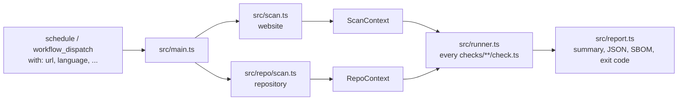

# Architecture

## Website

1. `src/crawl.ts` visits the start page, every link a language file names as a legal page (imprint, privacy policy, T&Cs, withdrawal instructions, ...), then a sample of the site's own pages, up to `max-pages`.
2. `src/capture.ts` loads each page twice in Chromium, JavaScript off and on. It records status, headers and their `<meta>` equivalents, text, links and buttons (also in shadow roots), forms, checkboxes, short struck-through texts with a digit (old prices), requests with status, Content-Type, Content-Encoding, Content-Length and cache headers (browser cache off), cookies with flags and expiry, localStorage, scripts and stylesheets with their `integrity`, images with `loading` and position against the first viewport, videos with their playback attributes, and size and colors of buttons in consent banners. On the load with JavaScript it runs the axe-core rules from `data/accessibility.yml` in the page (`page.evaluate`, not bound by the page's CSP, nothing loaded from the network) and keeps their violations: rule, count and the CSS selectors of the first `axe.max_targets` elements, never the page's HTML; axe-core gets `axe.timeout_ms` (`data/thresholds.yml`, at most the page timeout), and a page where it fails or runs out of time has no results, so the accessibility checks skip it. This adds about 0.1 to 0.4 seconds per page. It never clicks. Chromium runs with its sandbox; where the runner has none, the scan stops unless `require-sandbox: false`, and the report warns. It gets only `PATH`, `HOME` and locale variables, no tokens, and blocks downloads and service workers. Each load has an overall deadline, so a page that never yields becomes an error. Text (200 KB), links (2000), link labels (300 characters) and requests (5000) and struck-through texts (100) are capped. In the load with JavaScript it also keeps the bodies of documents and scripts once per URL across the crawl (`CodeCollector`, limits in `data/thresholds.yml` `code`), as `ScanContext.code`; bodies never reach the report.
3. `src/probe.ts` does the lookups that need no browser: paths from `data/probes.yml`, plain HTTP, the `www.` variant, TLS, SPF, DMARC and MX, IP countries of the start page's host and the third-party hosts when an IPinfo token is set, and green hosting of the start page's host at the Green Web Foundation unless `green-hosting: false`. `sourceMaps()` follows the `sourceMappingURL` of the site's own scripts: inline maps are decoded, maps on the same site requested up to `code.max_maps`, and only their `sources` are kept (`ScanContext.sourceMaps`).
   They run against the start page's final URL only if it is on the same site as the input URL, otherwise against the input URL.
4. `src/net.ts` keeps the scan off private networks. `publicAddresses()` resolves a host once and allows it only if every address is public; the connection then uses exactly these addresses (`pinned()`), so a DNS answer that changes in between (rebinding) cannot reach the runner's network. Requests without a browser use it directly, with redirects followed by hand and checked per hop. The browser connects only through `publicProxy()`, a local SOCKS5 proxy that does the same for every page, redirect, subresource and WebSocket. The host of the input URL is always allowed, so local dev servers and test fixtures work.
5. `src/context.ts` wraps everything in a read-only `ScanContext` with helpers.

Both loads happen without interaction, so every request and cookie in the context happened before consent. Comparing the two loads shows what needs JavaScript.

## Repository

`src/repo/scan.ts` lists tracked files, parses lockfiles with `src/repo/lockfiles.ts`, reads the project license, and asks [OSV](https://osv.dev) for known vulnerabilities (`src/repo/osv.ts`) unless the input `vulnerabilities` is `false`. Every OSV hit is kept; details (summary, severity, fixed version) are loaded for up to 100 of them, and the status says when some are missing. `src/repo/sbom.ts` turns the result into CycloneDX 1.6.

The file list comes from two git calls: `git ls-files --cached --others --exclude-standard` for the repository itself and `git ls-files --stage --recurse-submodules` for the files of checked-out submodules; a gitlink (mode 160000) in the second marks a submodule that is not checked out. Without git, or when git fails, the folder is walked, which ignores `.gitignore`. Only the checked-out files are read, never the history.

The scan reads every file once into a cache that the checks share, and records in `RepoContext.coverage` what it could not see or read: the file list source, submodules, Git LFS pointers, files over the limit or binary, lockfiles parsed, empty or unreadable, package files without a parser (`data/ecosystems.yml`), and private package sources from `.npmrc`, `.yarnrc.yml`, `resolved` URLs, requirements index URLs, git dependencies and go `replace` (`src/repo/coverage.ts`). Private sources are only named, never contacted. The report lists the coverage under the scan line and in `rechtzeitig-report.json`; `security/sbom`, `legal/unknown-licenses` and `security/secrets` use it so that a gap never ends as a pass.

`src/repo/licenses.ts` holds what the license rules in `checks/legal/` share, exported through `src/sdk.ts`: an SPDX expression parser (`OR`, `AND`, `WITH`, parentheses; anything else gives undefined, never an exception), the categories of `data/licenses.yml`, the least restrictive `OR` choice, which lockfiles carry license data (`licenses_in_lockfile` in `data/ecosystems.yml` and at least one package with a license field), and the comparison of a LICENSE file with its SPDX text. `dependencyLicenseResult()` in `src/sdk.ts` gives the copyleft, network copyleft and source-available rules one shape: a skip without a single license read, dev dependencies left out.

The repository is untrusted. Only regular files count: symlinks and devices are skipped, files are read without following links up to the `repo` limits in `data/thresholds.yml` (1 MB, known lockfiles 50 MB), and git runs without fsmonitor and system config, also for submodules.

## Rules and checks

Each check folder has `rule.yml` (metadata: id, severity, titles, legal basis, fix hint, review date, sources; schema in `src/rules.ts`) and `check.ts` (detection). Legal and wording updates are data changes in `rule.yml` and `lang/*.yml`, not engine changes.

`src/runner.ts` loads every `checks/**/check.ts` with its `rule.yml`. Website checks (`defineCheck`) get the `ScanContext`, repository checks (`defineRepoCheck`) get the `RepoContext`, and checks of both (`defineCrossCheck`, `run(ctx, repo)`) get both: findings only a scan of both can give, such as a package in the code that the privacy policy does not name, or a header the repository configures that the site does not send. The folder below `checks/` is the group, a legal or topic area such as `legal` or `security`; what a check reads is its scope, `scopeOf()` in `src/runner.ts` derives it from the check type (`website`, `repository`, `both`), so a group can hold checks of either scope. The input `modules` picks checks by group or scope (`repo` is the old name of `repository`); a check runs when either is listed. A check of both runs for `website` or `repository`, and `both` picks only those. It runs only when the URL and the checkout both exist; otherwise it is a skip with `because: { kind: "target", missing, both: true }` (`missing` is `url`, `repository` or `both`) and the message `messages.common.not_run_both_<missing>`, which the report lists on its own line. Like repository checks, a check of both reads `RepoContext.coverage`, so a file it could not read gives `info`, never a pass. Helpers shared by several checks live in `src/sdk.ts`: `findSecrets()` (secret patterns), `databaseRules()` (Supabase migrations, Firebase rules), `directPackages()` (runtime dependencies of every `package.json`), `ownFiles()` (shipped files without tests and fixtures), `siteCode()` and `hostsIn()` (the site's own served code and the hosts it names), `siteHosting()` (the hosting provider of `data/hosting.yml` whose response header the start page sends), `grepFiles()` (lines of the project's own files that patterns match, with the files it could not read), `consentInRepo()` and `consentOnSite()` (consent tools in the repository, banner and consent platforms on the start page). `ctx.matches()` returns what a `lang/*.yml` concept matched, `ctx.vendors` every entry of `data/third-parties.yml`. Each runs on its own with a timeout; a broken check becomes `error` and the rest still run. A rule that lists an input in `requires` (`SWITCHES` in `src/rules.ts`: a secret such as `IPINFO_TOKEN`, an opt-in like `subscriptions: true`, or an opt-out like `vulnerabilities: false`) is skipped unless `src/main.ts` finds that input on; the skip message is `messages.common.switch_<input>`. No check is ever left out of the outcomes: one without its target (no URL, no checkout) or outside `modules` is a skip too, and every skip carries `because` (`target`, `module`, `switch`, or `data` when the check itself found nothing to read). The report groups them under a collapsed "Not run" with how to turn them on. `npm run docs` turns the same list into the "What runs when" tables, so every API with a token is opt-in and every switch is documented. `src/main.ts` sets the exit code from `fail-on`.

A group is a legal or topic area with a legal basis, except `quality` (`NO_LEGAL_BASIS_GROUPS` in `src/rules.ts`): its rules have no `legal_basis` but a `value`, the benefit for the project, shown as "No legal basis: <value>" on `docs/checks.html`, in the report and in SARIF, so no finding there reads like a legal duty. The validator requires `value` there and forbids it next to a `legal_basis`.

## Source code

The code checks (`security/tls-verification-off`, `debug-mode`, `default-credentials`, `llm-key-in-browser`, `service-key-in-client`, `quality/*`) share `src/repo/code.ts`, exported through `src/sdk.ts`. `codeFiles()` gives every tracked file in a language of `data/code-paths.yml` (JS/TS, Python, Go, PHP, Ruby, shell including workflows, Dockerfiles and package.json, env files, Spring config) without vendored, built, generated, docs, examples and fixture paths, and without tests unless a check asks for only tests. `isClientFile()` says whether a file runs in the browser: a `"use client"` directive, a Vue or Svelte component, or `src/` next to a Vite config, unless the path names a server part. `findInCode()` matches patterns from `data/insecure-code.yml` or `data/code-quality.yml` per line (or per file with `whole`), skips comment lines unless a pattern asks for them and lines over `source-code.max_line_chars`, and gives at most one find per line. Finds carry file, line, key and at most a variable name, never the matched text.

`test/benchmark/` scores these checks on two sets, each with its own precision and recall per rule: `fixtures/real/` (excerpts of public repositories under a permissive license, with source, commit, license and label reasoning) and `fixtures/synthetic/` (cases written with the patterns). Minimums and the documented real-set exceptions are in `data/thresholds.yml` `benchmark` (`npm run benchmark` prints both tables).

## Findings

Messages and details carry text from the scanned site and repository. Every output passes them through `oneLine()` in `src/text.ts` (no control characters, at most 300 characters). The step summary escapes Markdown and HTML; the log is wrapped in `::stop-commands::` with a random token, so no line becomes a workflow command.

Checks return message keys with parameters, not sentences. `src/messages.ts` renders them in the report language from `lang/<code>.yml` `messages`, with plural forms from `Intl.PluralRules`. Findings with a file and line also become GitHub annotations (`toAnnotations` in `src/report.ts`); they are printed after the stop-commands block, so every value is escaped the way the Actions toolkit does it. GitHub shows at most 10 annotations per level and step; the step summary always has all findings, the artifact also every passed and skipped check.

`toFindings` in `src/report.ts` builds `rechtzeitig-report.json`: rule id, severity, status, message in the report language with its key and parameters, locations, `because` for skips, and the repository `coverage`, never page text or file contents. Findings stay in the workflow artifact; nothing is sent anywhere.

`report-visibility` decides what of this the run shows. `auto` (the default) reads `repository.private` and `repository.visibility` from the event payload (`GITHUB_EVENT_PATH`): private or internal gives `full`, anything else, a missing field included, gives the internal `counts`. Outside GitHub it is `full`. `full` as input always shows everything. `counts` prints `toCounts` to the log and the summary and writes no files, so the action uploads no artifact (kept for 7 days when there is one). The removed input values `counts` and `none` (`REMOVED_VISIBILITIES`) work like `auto` and print a `::warning::`. The report JSON is the interface for anything built on top of rechtzeitig.

`sarif-upload` (default `auto`, empty counts as `auto`) starts with `src/sarif-preflight.ts` in its own step, the only step that gets the job's token. It skips the upload for pull requests from forks and runs started by Dependabot (read-only token), and otherwise asks `GET /repos/{repo}/code-scanning/analyses` once: 200 or 404 uploads, 403 skips (no GitHub Code Security, or no `security-events: write`), anything else tries the upload. A skip is a `::notice::` (`true`: `::warning::`) and writes the output `upload=false`. With `upload=true` the scan gets `--sarif <file>` and writes `toSarif` from `src/sarif.ts`, independent of `report-visibility`, to `$RUNNER_TEMP/sarif/`, outside the artifact folder. The action then uploads it with `github/codeql-action/upload-sarif` (category `rechtzeitig`, `continue-on-error`); a failed upload becomes a notice or warning, never a failed job. Findings with a file point to file and line; the rest, website findings included, get one alert per rule at the workflow file from `GITHUB_WORKFLOW_REF`. `partialFingerprints` (`rechtzeitig/v1`) leave out the line (a finding can set its own `fingerprint` when its params change between runs, like the OSV summary), so an alert survives moved code, and with the fixed category each run updates the same alerts instead of adding new ones.

## Layout

| Path | Content |
|---|---|
| `src/sdk.ts` | The only API for checks: types, result helpers, both contexts |
| `src/`, `src/repo/` | Crawler, probes, repository scan, runner, report and findings format, CLI |
| `src/net.ts`, `src/text.ts` | Public-address checks for every request; `oneLine()` for untrusted text in outputs |
| `checks/<module>/<name>/` | One check: `rule.yml`, `check.ts`, `test.ts`, `fixtures/` |
| `src/rules.ts`, `src/docs.ts` | Rule schema and validator; generator for the rule cards and switch tables in `docs/checks.html` and `docs/workflow.html`, the rule count and review dates in `docs/index.html` and `docs/de/index.html`, and the rule lists of the topic pages |
| `lang/*.yml` | Words per language, as regular expressions |
| `data/third-parties.yml` | Known services: hosts, country, consent, cookies, npm packages of their SDKs, tag ids in code (`ids`), form endpoints (`forms`) |
| `data/probes.yml` | Paths to request without a browser |
| `data/secrets.yml` | Secret patterns (many adapted from gitleaks, MIT, see `NOTICE`), keywords, entropy level and placeholder words |
| `data/accessibility.yml` | axe-core rules per accessibility check |
| `data/licenses.yml` | License categories (source-available, network copyleft, copyleft, weak copyleft, permissive) with a family per pattern, and linking exceptions |
| `data/spdx.yml`, `data/license-texts.yml` | SPDX License List ids (current, deprecated, exceptions) and the reference texts of MIT, ISC, 0BSD, BSD-2-Clause, BSD-3-Clause and Apache-2.0 (CC-BY-3.0, SPDX) |
| `data/relicensing.yml` | Packages that changed their license from one version on, each checked against a primary source |
| `data/ai-models.yml` | Hugging Face model ids and weight file names with their licenses, and the extensions of weight files |
| `data/update-tools.yml` | Dependabot ecosystem names, Renovate config paths, vulnerability scanners |
| `data/countries.yml`, `data/cookies.yml`, `data/leaks.yml`, `data/outdated-links.yml`, `data/outdated-laws.yml`, `data/hsts-preload.yml`, `data/subresource-integrity.yml`, `data/file-formats.yml`, `data/google-tags.yml`, `data/shop.yml`, `data/workflow-risks.yml`, `data/fonts.yml`, `data/databases.yml`, `data/header-configs.yml`, `data/hosting.yml`, `data/consent-tools.yml`, `data/dev-builds.yml`, `data/legal-texts.yml` | Lists for single checks: EEA countries, session cookie names, error traces, closed services, repealed law names, HSTS-preloaded top-level domains, services whose files change under the same URL, file formats (legacy, static, compressible), Google tag endpoints and their consent parameters, price and address field formats for the shop checks, risky workflow patterns and AI agent actions, Google Fonts hosts and self-hosting packages, Supabase and Firebase hosts, security headers compared with hosting configs, hosting providers by deploy file and response header, consent libraries and platform loaders, dev server and debug build traces, files that hold legal texts |
| `data/agent-files.yml` | AI agent instruction and config files (CLAUDE.md, AGENTS.md, .cursorrules, MCP configs, .claude/settings.json), credential keys and placeholders, blanket permission rules and flags, package runners, for the `agent-*` checks |
| `data/hidden-unicode.yml` | Code point ranges of invisible characters (bidi controls, tags, zero-width, marks, variation selectors), where each counts, and the source file extensions |
| `data/packages.yml` | Popular package names per ecosystem and allowed look-alikes, lockfiles per package manager, platform and non-registry specs; with `src/repo/manifests.ts` (direct dependencies of package.json, composer.json, pubspec.yaml, Cargo.toml, pyproject.toml and the lockfile that locks each) and `src/repo/semver.ts` (npm and Cargo ranges) for `hallucinated-packages` and `lockfile-drift` |
| `data/source-domains.yml` | Domains allowed in `meta.sources` of a rule, checked by `src/rules.ts` |
| `data/code-paths.yml`, `data/insecure-code.yml`, `data/code-quality.yml` | Code checks: languages, skipped paths, tests and browser files (`src/repo/code.ts`); insecure patterns per rule and language; quality patterns |
| `data/thresholds.yml` | Every number a check decides by, one section per check; `common.max_listed` caps the items in one finding (`capped()` in `src/sdk.ts`) |
| `test/helpers.ts` | Serves a fixture on localhost, builds sites, repositories and contexts for tests; `runCrossCheck` runs a check of both against a site fixture and a repository |
| `docs/` | User documentation: plain HTML and one `style.css`, published with GitHub Pages, no build. `npm run docs` fills what stands between `<!-- name:start -->` and `<!-- name:end -->` markers: the rule cards in `checks.html` (with the German title, the scope as `data-scope` and a label, and one `id` per group for links like `checks.html#privacy`; `checks.js` also reads `#both`, `#website`, `#repository` and the old `#repo` as scope filters; the "Repository + website" chip comes first and is highlighted), the "What runs when" tables, on `index.html` and `de/index.html` the rule count (`hero-checks`), the list of checks of both scopes by title (`cross-checks`) and the number of checks per scope (`count-both`, `count-repository`, `count-website`), so the page never claims more than the code has, and the oldest and newest `meta.last_reviewed` (`reviewed`), and the rule list (`topic-rules`) of the topic pages. Topic pages cover one subject for search: `security.html` lists every website rule in `checks/security/`, `de/kuendigungsbutton.html` the rules in `SHOP_RULES` of `src/docs.ts`; their other text is written by hand and must match those rules. `docs/de/` holds the German start page, imprint (`impressum.html`) and privacy policy (`datenschutz.html`) and German-only topic pages; a German page links one folder up and marks English targets with `hreflang="en"`. Pages with a counterpart in the other language name both, plus `x-default` (the English page), in `<link rel="alternate" hreflang>` and in `sitemap.xml`, and carry the language switch in the header; `site.js` reads these links to open the counterpart in the browser's language and stores `lang` only when a visitor picks a language other than the browser's. `src/site.test.ts` checks canonicals, hreflang pairs, the sitemap and one CSP for all pages. The FAQ in `index.html` and `de/index.html` is repeated as `FAQPage` JSON-LD in its `<head>`; change both together (a test compares them). The example report on both start pages is copied from real runs; change both together, and mark anything that is not tool output as "Our note". Link labels in the start page's content must not match the `imprint` or `privacy` link words in `lang/*.yml`, or a scan of the site takes that link for the legal page. Header and footer are copied into every page, so change them in all of them. `privacy.html` and `de/datenschutz.html` must stay true when the site starts loading or tracking anything new. `imprint.html` and `de/impressum.html` hold the provider details under § 5 DDG; update both when they change. The seal in the header and `favicon.svg` is a `<path>` outline of the §, not text, so it stays centred in every font; `node dev/icons.mjs` renders the PNG and ICO icons and `og.png` (from `dev/og-image.html`). In page text the product name is written `rechtzeitig` (not in titles, meta, JSON-LD, code or the header), so it is not read as the German adverb, which would be `rechtzeitig`; `src/site.test.ts` flags a bare one. `site.js` adds a Copy button to every code block except `pre.excerpt`, a snippet that only shows where something goes |
| `action.yml` | Composite action: Node 24, Playwright, AppArmor profile for the Chrome sandbox on GitHub-hosted Ubuntu, code scanning check, scan, upload report and SARIF. Empty inputs (runs without the Run workflow dialog) use the defaults of `CLI_OPTIONS` in `src/options.ts`, applied by `src/main.ts` |
| `.github/workflows/release.yml` | Release by hand (Actions → release → Run workflow, patch, minor or major): runs `test.yml`, bumps the latest tag, commits `package.json` on top of the tested commit, pushes only the tag, publishes the release (a pre-release before v1.0.0), then opens a pull request to `main` with the version and `examples/workflows/rechtzeitig.yml` pinned to the release SHA and starts `test.yml` on it. Nothing pushes to `main`, which takes changes only through pull requests |

## Choices

- TypeScript without a build step. Node 24 runs `.ts` files directly; `tsc` only type-checks.
- Three runtime dependencies: `playwright`, `yaml` and `axe-core` (MPL-2.0, pinned). axe-core is the accessibility engine most tools build on, its rules are tested against the W3C ACT rules, and writing the same checks for names, alt texts and contrast by hand would be a worse copy. It has no dependencies of its own and is used unchanged (file-level copyleft, named in `NOTICE`). Only the rules in `data/accessibility.yml` run, never a full run. Secret patterns adapted from gitleaks (MIT) are data in `data/secrets.yml`, not a dependency; trufflehog (AGPL-3.0) is not used, neither code nor detector definitions, and no secret is ever sent to a vendor to verify it.
- Tests use `node:test` and real Chromium against local fixtures. Requests to other hosts are recorded, then aborted by a route (`offline`); DNS, TLS and OSV are skipped. Tests run offline.
- The runner location is part of the result. GitHub-hosted runners are in the US; the report says so.
