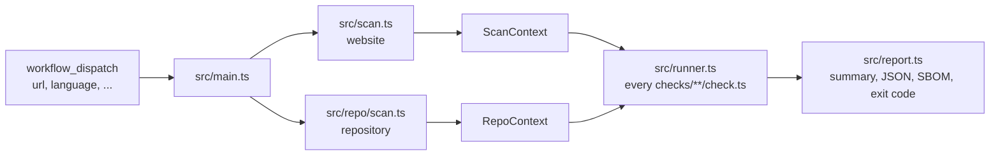

# Architecture

## Website

1. `src/crawl.ts` visits the start page, every link a language file names as a legal page (imprint, privacy policy, T&Cs, withdrawal instructions, ...), then a sample of the site's own pages, up to `max-pages`.
2. `src/capture.ts` loads each page twice in Chromium, JavaScript off and on. It records status, headers and their `<meta>` equivalents, text, links and buttons (also in shadow roots), forms, checkboxes, short struck-through texts with a digit (old prices), requests with status, Content-Type, Content-Encoding, Content-Length and cache headers (browser cache off), cookies with flags and expiry, localStorage, scripts and stylesheets with their `integrity`, images with `loading` and position against the first viewport, videos with their playback attributes, and size and colors of buttons in consent banners. It never clicks. Chromium runs with its sandbox; where the runner has none, the scan stops unless `require-sandbox: false`, and the report warns. It gets only `PATH`, `HOME` and locale variables, no tokens, and blocks downloads and service workers. Each load has an overall deadline, so a page that never yields becomes an error. Text (200 KB), links (2000), link labels (300 characters) and requests (5000) and struck-through texts (100) are capped.
3. `src/probe.ts` does the lookups that need no browser: paths from `data/probes.yml`, plain HTTP, the `www.` variant, TLS, SPF, DMARC and MX, IP countries when an IPinfo token is set, and green hosting of the start page's host at the Green Web Foundation unless `green-hosting: false`.
   They run against the start page's final URL only if it is on the same site as the input URL, otherwise against the input URL.
4. `src/net.ts` keeps the scan off private networks. `publicAddresses()` resolves a host once and allows it only if every address is public; the connection then uses exactly these addresses (`pinned()`), so a DNS answer that changes in between (rebinding) cannot reach the runner's network. Requests without a browser use it directly, with redirects followed by hand and checked per hop. The browser connects only through `publicProxy()`, a local SOCKS5 proxy that does the same for every page, redirect, subresource and WebSocket. The host of the input URL is always allowed, so local dev servers and test fixtures work.
5. `src/context.ts` wraps everything in a read-only `ScanContext` with helpers.

Both loads happen without interaction, so every request and cookie in the context happened before consent. Comparing the two loads shows what needs JavaScript.

## Repository

`src/repo/scan.ts` lists tracked files, parses lockfiles with `src/repo/lockfiles.ts`, reads the project license, and asks [OSV](https://osv.dev) for known vulnerabilities (`src/repo/osv.ts`) unless the input `vulnerabilities` is `false`. Every OSV hit is kept; details (summary, severity, fixed version) are loaded for up to 100 of them, and the status says when some are missing. `src/repo/sbom.ts` turns the result into CycloneDX 1.6.

The repository is untrusted. Only regular files count: symlinks and devices are skipped, files are read up to 1 MB without following links, and git runs without fsmonitor and system config.

## Rules and checks

Each check folder has `rule.yml` (metadata: id, severity, titles, legal basis, fix hint, review date, sources; schema in `src/rules.ts`) and `check.ts` (detection). Legal and wording updates are data changes in `rule.yml` and `lang/*.yml`, not engine changes.

`src/runner.ts` loads every `checks/**/check.ts` with its `rule.yml`. Website checks get the `ScanContext`, repository checks (`checks/repo/`) get the `RepoContext`. Each runs on its own with a timeout; a broken check becomes `error` and the rest still run. A rule that lists an input in `requires` (`SWITCHES` in `src/rules.ts`: a secret such as `IPINFO_TOKEN`, an opt-in like `subscriptions: true`, or an opt-out like `vulnerabilities: false`) is skipped unless `src/main.ts` finds that input on; the skip message is `messages.common.switch_<input>`. `npm run docs` turns the same list into the "What runs when" tables, so every API with a token is opt-in and every switch is documented. `src/main.ts` sets the exit code from `fail-on`.

## Findings

Messages and details carry text from the scanned site and repository. Every output passes them through `oneLine()` in `src/text.ts` (no control characters, at most 300 characters). The step summary escapes Markdown and HTML; the log is wrapped in `::stop-commands::` with a random token, so no line becomes a workflow command.

Checks return message keys with parameters, not sentences. `src/messages.ts` renders them in the report language from `lang/<code>.yml` `messages`, with plural forms from `Intl.PluralRules`. Findings with a file and line also become GitHub annotations (`toAnnotations` in `src/report.ts`); they are printed after the stop-commands block, so every value is escaped the way the Actions toolkit does it. GitHub shows at most 10 annotations per level and step; the step summary always has all findings, the artifact also every passed and skipped check.

`toFindings` in `src/report.ts` builds `rechtzeitig-report.json`: rule id, severity, status, message in the report language with its key and parameters, and locations, never page text or file contents. Findings stay in the workflow artifact; nothing is sent anywhere.

`report-visibility` decides what of this the run shows. `auto` reads `repository.private` and `repository.visibility` from the event payload (`GITHUB_EVENT_PATH`): private or internal gives `full`, anything else, a missing field included, gives `counts`. Outside GitHub it is `full`. `counts` prints `toCounts` to the log and the summary and writes no files, so the action uploads no artifact; `none` prints one line. The report JSON is the interface for anything built on top of rechtzeitig.

`--sarif <file>` (input `sarif-upload`) writes `toSarif` from `src/sarif.ts`, independent of `report-visibility`, to `$RUNNER_TEMP/sarif/`, outside the artifact folder. The action then uploads it with `github/codeql-action/upload-sarif` (category `rechtzeitig`, `continue-on-error`). Findings with a file point to file and line; the rest, website findings included, get one alert per rule at the workflow file from `GITHUB_WORKFLOW_REF`. Fingerprints leave out the line, so an alert survives moved code.

## Layout

| Path | Content |
|---|---|
| `src/sdk.ts` | The only API for checks: types, result helpers, both contexts |
| `src/`, `src/repo/` | Crawler, probes, repository scan, runner, report and findings format, CLI |
| `src/net.ts`, `src/text.ts` | Public-address checks for every request; `oneLine()` for untrusted text in outputs |
| `checks/<module>/<name>/` | One check: `rule.yml`, `check.ts`, `test.ts`, `fixtures/` |
| `src/rules.ts`, `src/docs.ts` | Rule schema and validator; generator for the rule cards and switch tables in `docs/checks.html` and `docs/workflow.html`, the rule count and review dates in `docs/index.html` and `docs/de/index.html`, and the rule lists of the topic pages |
| `lang/*.yml` | Words per language, as regular expressions |
| `data/third-parties.yml` | Known services: hosts, country, consent, cookies |
| `data/probes.yml` | Paths to request without a browser |
| `data/secrets.yml` | Secret patterns |
| `data/licenses.yml` | License groups: AGPL, GPL, restricted, permissive |
| `data/update-tools.yml` | Dependabot ecosystem names, Renovate config paths, vulnerability scanners |
| `data/countries.yml`, `data/cookies.yml`, `data/leaks.yml`, `data/outdated-links.yml`, `data/outdated-laws.yml`, `data/hsts-preload.yml`, `data/subresource-integrity.yml`, `data/file-formats.yml`, `data/google-tags.yml`, `data/shop.yml`, `data/workflow-risks.yml` | Lists for single checks: EEA countries, session cookie names, error traces, closed services, repealed law names, HSTS-preloaded top-level domains, services whose files change under the same URL, file formats (legacy, static, compressible), Google tag endpoints and their consent parameters, price and address field formats for the shop checks, risky workflow patterns |
| `data/source-domains.yml` | Domains allowed in `meta.sources` of a rule, checked by `src/rules.ts` |
| `data/thresholds.yml` | Every number a check decides by, one section per check; `common.max_listed` caps the items in one finding (`capped()` in `src/sdk.ts`) |
| `test/helpers.ts` | Serves a fixture on localhost, builds repositories and contexts for tests |
| `docs/` | User documentation: plain HTML and one `style.css`, published with GitHub Pages, no build. `npm run docs` fills what stands between `<!-- name:start -->` and `<!-- name:end -->` markers: the rule cards in `checks.html` (with the German title, and one `id` per group for links like `checks.html#privacy`), the "What runs when" tables, on `index.html` and `de/index.html` the rule count (`hero-checks`) and the oldest and newest `meta.last_reviewed` (`reviewed`), and the rule list (`topic-rules`) of the topic pages. Topic pages cover one subject for search: `security.html` lists every rule in `checks/security/`, `de/kuendigungsbutton.html` the rules in `SHOP_RULES` of `src/docs.ts`; their other text is written by hand and must match those rules. `docs/de/` holds the German start page, imprint (`impressum.html`) and privacy policy (`datenschutz.html`) and German-only topic pages; a German page links one folder up and marks English targets with `hreflang="en"`. Pages with a counterpart in the other language name both, plus `x-default` (the English page), in `<link rel="alternate" hreflang>` and in `sitemap.xml`, and carry the language switch in the header; `site.js` reads these links to open the counterpart in the browser's language and stores `lang` only when a visitor picks a language other than the browser's. `src/site.test.ts` checks canonicals, hreflang pairs, the sitemap and one CSP for all pages. The FAQ in `index.html` and `de/index.html` is repeated as `FAQPage` JSON-LD in its `<head>`; change both together (a test compares them). The example report on both start pages is copied from real runs; change both together, and mark anything that is not tool output as "Our note". Link labels in the start page's content must not match the `imprint` or `privacy` link words in `lang/*.yml`, or a scan of the site takes that link for the legal page. Header and footer are copied into every page, so change them in all of them. `privacy.html` and `de/datenschutz.html` must stay true when the site starts loading or tracking anything new. `imprint.html` and `de/impressum.html` hold the provider details under § 5 DDG; update both when they change |
| `action.yml` | Composite action: Node 24, Playwright, AppArmor profile for the Chrome sandbox on GitHub-hosted Ubuntu, scan, upload report |
| `.github/workflows/release.yml` | Release by hand (Actions → release → Run workflow, patch, minor or major): runs `test.yml`, bumps the latest tag, commits `package.json` on top of the tested commit, pushes only the tag, publishes the release (a pre-release before v1.0.0), then opens a pull request to `main` with the version and `examples/workflows/rechtzeitig.yml` pinned to the release SHA and starts `test.yml` on it. Nothing pushes to `main`, which takes changes only through pull requests |

## Choices

- TypeScript without a build step. Node 24 runs `.ts` files directly; `tsc` only type-checks.
- Two runtime dependencies: `playwright` and `yaml`.
- Tests use `node:test` and real Chromium against local fixtures. Requests to other hosts are recorded, then aborted by a route (`offline`); DNS, TLS and OSV are skipped. Tests run offline.
- The runner location is part of the result. GitHub-hosted runners are in the US; the report says so.
