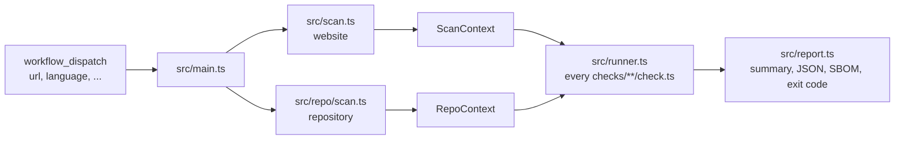

# Architecture

## Website

1. `src/crawl.ts` visits the start page, every link a language file names as a legal page, then a sample of the site's own pages, up to `max-pages`.
2. `src/capture.ts` loads each page twice in Chromium, JavaScript off and on. It records status, headers, text, links and buttons (also in shadow roots), forms, checkboxes, requests, cookies with flags, and localStorage. It never clicks. Chromium runs with its sandbox (without it only where the runner cannot, with a warning in the report), gets only `PATH`, `HOME` and locale variables, no tokens, and blocks downloads and service workers. Each load has an overall deadline, so a page that never yields becomes an error. Text (200 KB), links (2000), link labels (300 characters) and requests (5000) are capped.
3. `src/probe.ts` does the lookups that need no browser: paths from `data/probes.yml`, plain HTTP, the `www.` variant, TLS, SPF/DMARC, and IP countries when an IPinfo token is set.
   They run against the start page's final URL only if it is on the same site as the input URL, otherwise against the input URL.
4. `src/net.ts` keeps the scan off private networks. Before each request without a browser, and before visiting any page, the host must resolve to public addresses only; redirects are followed by hand and checked per hop. In the browser, requests to `localhost` and private IP literals are aborted. The host of the input URL is always allowed, so local dev servers and test fixtures work.
5. `src/context.ts` wraps everything in a read-only `ScanContext` with helpers.

Both loads happen without interaction, so every request and cookie in the context happened before consent. Comparing the two loads shows what needs JavaScript.

## Repository

`src/repo/scan.ts` lists tracked files, parses lockfiles with `src/repo/lockfiles.ts`, reads the project license, and asks [OSV](https://osv.dev) for known vulnerabilities (`src/repo/osv.ts`). `src/repo/sbom.ts` turns the result into CycloneDX 1.6.

The repository is untrusted. Only regular files count: symlinks and devices are skipped, files are read up to 1 MB without following links, and git runs without fsmonitor and system config.

## Rules and checks

Each check folder has `rule.yml` (metadata: id, severity, tier, titles, legal basis, fix hint, review date, sources; schema in `src/rules.ts`) and `check.ts` (detection). Legal and wording updates are data changes in `rule.yml` and `lang/*.yml`, not engine changes.

`src/runner.ts` loads every `checks/**/check.ts` with its `rule.yml`. Website checks get the `ScanContext`, repository checks (`checks/repo/`) get the `RepoContext`. Each runs on its own with a timeout; a broken check becomes `error` and the rest still run. `src/main.ts` sets the exit code from `fail-on`.

## Findings and upload

Messages and details carry text from the scanned site and repository. Every output passes them through `oneLine()` in `src/text.ts` (no control characters, at most 300 characters). The step summary escapes Markdown and HTML; the log is wrapped in `::stop-commands::` with a random token, so no line becomes a workflow command.

`src/sink.ts` defines what may leave the runner: rule id, severity, status, message and locations, never page text or file contents. `rechtzeitig-report.json` has exactly this shape. Today the only sink keeps findings in the artifact. A later upload implements the same `FindingsSink` interface and is used only when the user sets an API key.

`tier: pro` rules never live in this repository. If they come, they arrive as data at run time and use the same open engine, so the engine itself has no paid code paths.

## Layout

| Path | Content |
|---|---|
| `src/sdk.ts` | The only API for checks: types, result helpers, both contexts |
| `src/`, `src/repo/` | Crawler, probes, repository scan, runner, report, CLI |
| `src/net.ts`, `src/text.ts` | Public-address checks for every request; `oneLine()` for untrusted text in outputs |
| `checks/<module>/<name>/` | One check: `rule.yml`, `check.ts`, `test.ts`, `fixtures/` |
| `src/rules.ts`, `src/docs.ts` | Rule schema and validator; generator for `docs/checks.md` |
| `src/sink.ts` | Findings format and where they go |
| `lang/*.yml` | Words per language, as regular expressions |
| `data/third-parties.yml` | Known services: hosts, country, consent, cookies |
| `data/probes.yml` | Paths to request without a browser |
| `data/secrets.yml` | Secret patterns |
| `test/helpers.ts` | Serves a fixture on localhost, builds repositories and contexts for tests |
| `docs/` | User documentation, published with GitHub Pages |
| `action.yml` | Composite action: Node 24, Playwright, scan, upload report |

## Choices

- TypeScript without a build step. Node 24 runs `.ts` files directly; `tsc` only type-checks.
- Two runtime dependencies: `playwright` and `yaml`.
- Tests use `node:test` and real Chromium against local fixtures. Requests to other hosts are recorded, then blocked; DNS, TLS and OSV are skipped. Tests run offline.
- The runner location is part of the result. GitHub-hosted runners are in the US; the report says so.
