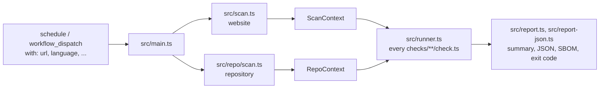

# Architecture

## Website

1. The scan languages are the packs in `lang/` whose words the checks look for. `language: auto` (the default) picks them once the start page loaded: `detectLanguages()` in `src/lang.ts` takes its `<html lang>`, then its hreflang alternates, by primary subtag, and keeps those `lang/` has; none gives `de` (`DEFAULT_LANGUAGE`). The browser asks for that default until then. `ScanContext.languagesFrom` (`input`, `page`, `default`) goes into the summary and the report JSON (`target.languages_from`).
   `src/crawl.ts` visits the start page, its version in a scan language when the start page announces one on the same site, within `max-pages` (`<link rel="alternate" hreflang>`, then `CrawlData.langPage`), every link a language file names as a legal page (imprint, privacy policy, T&Cs, withdrawal instructions, ...; matched with the link words of every language in `lang/`, the language version's links first), then a sample of the site's own pages, up to `max-pages`.
2. `src/capture.ts` loads each page twice in Chromium, JavaScript off and on. It records status, headers and their `<meta>` equivalents, the `<link rel="alternate" hreflang>` entries (`alternates`), text, links and buttons (also in shadow roots), forms, checkboxes, short struck-through texts with a digit (old prices), requests with status, Content-Type, Content-Encoding, Content-Length and cache headers (browser cache off), cookies with flags and expiry, localStorage, scripts and stylesheets with their `integrity`, images with `loading` and position against the first viewport, videos with their playback attributes, and size and colors of buttons in consent banners, and marks links and buttons that are not rendered or disabled as `hidden`. On the load with JavaScript it runs the axe-core rules from `data/accessibility.yml` in the page, plus its own rules from `custom` there (a CSS selector each, added with `axe.configure`) (`page.evaluate`, not bound by the page's CSP, nothing loaded from the network) and keeps their violations: rule, count and the CSS selectors of the first `axe.max_targets` elements, never the page's HTML; axe-core gets `axe.timeout_ms` (`data/thresholds.yml`, at most the page timeout), and a page where it fails or runs out of time has no results, so the accessibility checks skip it. This adds about 0.1 to 0.4 seconds per page. It never clicks. Chromium runs with its sandbox; where the runner has none, the scan stops unless `require-sandbox: false`, and the report warns. It gets only `PATH`, `HOME` and locale variables, no tokens, and blocks downloads and service workers. Each load has an overall deadline, so a page that never yields becomes an error. Text (200 KB), links (2000), link labels (300 characters) and requests (5000) and struck-through texts (100) are capped. In the load with JavaScript it also keeps the bodies of documents and scripts once per URL across the crawl (`CodeCollector`, limits in `data/thresholds.yml` `code`; a slot is reserved before a body is read, and a body larger than `max_file_chars` can hold (counted while it arrives, so a chunked response without Content-Length is bounded as well) is not read), as `ScanContext.code`; bodies never reach the report.
3. `src/probe.ts` does the lookups that need no browser: paths from `data/probes.yml`, plain HTTP, the `www.` variant, TLS, SPF, DMARC and MX, IP countries of the start page's host and the third-party hosts when an IPinfo token is set, and green hosting of the start page's host at the Green Web Foundation unless `green-hosting: false`. `sourceMaps()` follows the `sourceMappingURL` of the site's own scripts: inline maps are decoded, maps on the same site requested up to `code.max_maps`, and only their `sources` are kept (`ScanContext.sourceMaps`).
   They run against the start page's final URL only if it is on the same site as the input URL, otherwise against the input URL.
4. `src/net.ts` keeps the scan off private networks. `publicAddresses()` resolves a host once and allows it only if every address is public; the connection then uses exactly these addresses (`pinned()`), so a DNS answer that changes in between (rebinding) cannot reach the runner's network. Requests without a browser use it directly, with redirects followed by hand and checked per hop. The browser connects only through `publicProxy()`, a local SOCKS5 proxy that does the same for every page, redirect, subresource and WebSocket. The host of the input URL is always allowed, so local dev servers and test fixtures work.
5. `src/context.ts` wraps everything in a read-only `ScanContext` with helpers.

A "site" everywhere above (own pages, same-site crawling, source maps, `isThirdParty`, SPF and DMARC) is the registrable domain from `siteOf()` in `src/text.ts`: the longest matching rule of the Public Suffix List plus one label, wildcard and exception rules included. The list, ICANN and private section (so `shop.azurewebsites.net` and `tracker.azurewebsites.net` are two sites), is kept unmodified under MPL-2.0 in `data/public-suffixes.dat` and refreshed with `npm run refresh-suffixes`; it is read once, on the first call. IP addresses, hosts without a dot and public suffixes themselves stay as they are; an unknown TLD counts as one label.

Both loads happen without interaction, so every request and cookie in the context happened before consent. Comparing the two loads shows what needs JavaScript.

## Repository

`src/repo/scan.ts` lists tracked files, parses lockfiles with `src/repo/lockfiles.ts`, reads the project license, and asks [OSV](https://osv.dev) for known vulnerabilities (`src/repo/osv.ts`) unless the input `vulnerabilities` is `false`. Every OSV hit is kept; details (summary, severity, fixed version) are loaded for up to 100 of them, and the status says when some are missing. `src/repo/sbom.ts` turns the result into CycloneDX 1.6.

The file list comes from two git calls: `git ls-files --cached --others --exclude-standard` for the repository itself and `git ls-files --stage --recurse-submodules` for the files of checked-out submodules; a gitlink (mode 160000) in the second marks a submodule that is not checked out. Without git, or when git fails, the folder is walked, which ignores `.gitignore`. Only the checked-out files are read, never the history.

The scan reads every file once for the coverage report but keeps no text from that pass; checks that read a file get its text from an LRU cache bounded by `repo.cache_bytes` (`data/thresholds.yml`), and an evicted file is re-read from disk. The scan records in `RepoContext.coverage` what it could not see or read: the file list source, submodules, Git LFS pointers, files over the limit or binary, lockfiles parsed, empty or unreadable, package files without a parser (`data/ecosystems.yml`), and private package sources from `.npmrc`, `.yarnrc.yml`, `resolved` URLs, requirements index URLs, git dependencies and go `replace` (`src/repo/coverage.ts`). Private sources are only named, never contacted. The report lists the coverage under the scan line and in `rechtzeitig-report.json`; `security/sbom`, `legal/unknown-licenses`, `security/secrets` and `security/vulnerabilities` use it so that a gap never ends as a pass; checks that read single files return `unreadResult()` from `src/sdk.ts` (info, the files over the limit or only LFS pointers) instead of a pass, and `codeResult()` does so for the code checks.

No pass without the evidence it needs, on the website side as well: a pass that rests on the requests, cookies or services of the visited pages becomes `jsIncomplete(ctx)` (warn, the pages of `ctx.jsFailed`; info for cookie lifetime, cookie flags and mixed content) when a load with JavaScript failed, a check that reads links, text, forms or headers reads such a page from its load without JavaScript (`ctx.observedPages`), a probe or source map request without an answer (`status: 0`) leaves its check at info, and a comparison of two loads skips when one of them failed. axe-core keeps why it gave no result on a page (`axeError`: "timeout" or the error), and `axeResult()` warns with page and reason instead of passing the rest. `ctx.codeSkipped` counts only the site's own files that were not kept, since the code checks read only those.

`src/repo/licenses.ts` holds what the license rules in `checks/legal/` share, exported through `src/sdk.ts`: an SPDX expression parser (`OR`, `AND`, `WITH`, parentheses; anything else gives undefined, never an exception), the categories of `data/licenses.yml`, the least restrictive `OR` choice, which lockfiles carry license data (`licenses_in_lockfile` in `data/ecosystems.yml` and at least one package with a license field), and the comparison of a LICENSE file with its SPDX text. `dependencyLicenseResult()` in `src/sdk.ts` gives the copyleft, network copyleft and source-available rules one shape: a skip without a single license read, dev dependencies left out.

The repository is untrusted. Only regular files count: symlinks and devices are skipped, files are read without following links up to the `repo` limits in `data/thresholds.yml` (1 MB, known lockfiles 50 MB), and git runs without fsmonitor and system config, also for submodules.

## Rules and checks

Each check folder has `rule.yml` (metadata: id, severity, title, legal basis, fix hint, in English; review date, sources; schema in `src/rules.ts`) and `check.ts` (detection). Legal and wording updates are data changes in `rule.yml` and `lang/*.yml`, not engine changes.

`src/runner.ts` loads every `checks/**/check.ts` with its `rule.yml`, whose structure `validateRule()` in `src/rules.ts` checks; the age of `meta.last_reviewed` (`reviewProblems()`) is checked only by the tests and `npm run docs`, never by a scan, so a pinned release keeps scanning. Website checks (`defineCheck`) get the `ScanContext`, repository checks (`defineRepoCheck`) get the `RepoContext`, and checks of both (`defineCrossCheck`, `run(ctx, repo)`) get both: findings only a scan of both can give, such as a package in the code that the privacy policy does not name, or a header the repository configures that the site does not send. The folder below `checks/` is the group, a legal or topic area such as `legal` or `security`; what a check reads is its scope, `scopeOf()` in `src/runner.ts` derives it from the check type (`website`, `repository`, `both`), so a group can hold checks of either scope. The input `modules` picks checks by group or scope (`repo` is the old name of `repository`); a check runs when either is listed. A check of both runs for `website` or `repository`, and `both` picks only those. It runs only when the URL and the checkout both exist; otherwise it is a skip with `because: { kind: "target", missing, both: true }` (`missing` is `url`, `repository` or `both`) and the message `messages.common.not_run_both_<missing>`, which the report lists on its own line. Like repository checks, a check of both reads `RepoContext.coverage`, so a file it could not read gives `info`, never a pass. Helpers shared by several checks live in `src/sdk.ts`: `findSecrets()` (secret patterns), `databaseRules()` (Supabase migrations, Firebase rules), `directPackages()` (runtime dependencies of every `package.json`), `ownFiles()` (shipped files without tests and fixtures), `siteCode()` and `hostsIn()` (the site's own served code and the hosts it names), `siteHosting()` (the hosting provider of `data/hosting.yml` whose response header the start page sends), `grepFiles()` (lines of the project's own files that patterns match, with the files it could not read), `consentInRepo()` and `consentOnSite()` (consent tools in the repository, banner and consent platforms on the start page). `ctx.matches()` returns what a `lang/*.yml` concept matched, `ctx.vendors` every entry of `data/third-parties.yml`. Each runs on its own with a timeout; a broken check becomes `error` and the rest still run. A rule that lists an input in `requires` (`SWITCHES` in `src/rules.ts`: a secret such as `IPINFO_TOKEN`, an opt-in like `subscriptions: true`, or an opt-out like `vulnerabilities: false`) is skipped unless `src/main.ts` finds that input on; the skip message is `messages.common.switch_<input>`. No check is ever left out of the outcomes: one without its target (no URL, no checkout) or outside `modules` is a skip too, and every skip carries `because` (`target`, `module`, `switch`, or `data` when the check itself found nothing to read). The report groups them under a collapsed "Not run" with how to turn them on. `npm run docs` turns the same list into the "What runs when" tables, so every API with a token is opt-in and every switch is documented. `src/main.ts` sets the exit code from `fail-on`.

A group is a legal or topic area with a legal basis, except `quality` (`NO_LEGAL_BASIS_GROUPS` in `src/rules.ts`): its rules have no `legal_basis` but a `value`, the benefit for the project, shown as "No legal basis: <value>" in the wiki, in the report and in SARIF, so no finding there reads like a legal duty. The validator requires `value` there and forbids it next to a `legal_basis`.

## Source code

The code checks (`security/tls-verification-off`, `debug-mode`, `default-credentials`, `llm-key-in-browser`, `service-key-in-client`, `quality/*`) share `src/repo/code.ts`, exported through `src/sdk.ts`. `codeFiles()` gives every tracked file in a language of `data/code-paths.yml` (JS/TS, Python, Go, PHP, Ruby, shell including workflows, Dockerfiles and package.json, env files, Spring config) without vendored, built, generated, docs, examples and fixture paths, and without tests unless a check asks for only tests. `isClientFile()` says whether a file runs in the browser: a `"use client"` directive, a Vue or Svelte component, or `src/` next to a Vite config, unless the path names a server part. `findInCode()` matches patterns from `data/insecure-code.yml` or `data/code-quality.yml` per line (or per file with `whole`), skips comment lines unless a pattern asks for them and lines over `source-code.max_line_chars`, and gives at most one find per line. Finds carry file, line, key and at most a variable name, never the matched text.

`test/benchmark/` scores these checks on two sets, each with its own precision and recall per rule: `fixtures/real/` (excerpts of public repositories under a permissive license, with source, commit, license and label reasoning) and `fixtures/synthetic/` (cases written with the patterns). Minimums and the documented real-set exceptions are in `data/thresholds.yml` `benchmark` (`npm run benchmark` prints both tables).

## Suppressions

`src/suppress.ts` reads `.github/rechtzeitig.yml` in the scanned repository (a regular file up to `repo.max_file_bytes`, never through a symlink) and validates each entry under `suppress`: a known rule id, a category from `CATEGORIES` (`not-applicable`, `false-positive`, `accepted-risk`), a reason that is no placeholder from `data/suppressions.yml` and has `quality/suppressions.min_reason_chars`, and `expires` as a real day that has not passed and lies at most `max_expiry_days` ahead (`data/thresholds.yml`), required for `NEEDS_EXPIRY`. Only valid entries apply. `src/main.ts` reads the file from the checkout even when no repository check runs, and `applySuppressions()` turns the outcome of each listed rule that ran into status `suppressed`, keeping message, details and the status it would have (`Outcome.suppression`); a skip stays a skip. `suppressed` never counts for `fail-on`, gives no annotation, shows in the report with reason and place, in the report JSON as `suppression`, and in SARIF as a `suppressions` entry at the level the rule would have. The rule `quality/suppressions` (`QUAL-SUPPRESS-001`) calls the same parser, so what it reports and what is turned off cannot differ; it fails for every problem with its line and cannot suppress itself. `npm run docs` writes `examples/rechtzeitig.schema.json` from the rule ids for editor completion; the scan does not use it.

## Findings

Messages and details carry text from the scanned site and repository. Every output passes them through `oneLine()` in `src/text.ts` (no control characters, at most 300 characters). The step summary escapes Markdown and HTML; the log is wrapped in `::stop-commands::` with a random token, so no line becomes a workflow command.

Checks return message keys with parameters, not sentences. `src/messages.ts` renders them in English from `lang/en.yml` `messages`, with plural forms from `Intl.PluralRules`; the other files in `lang/` hold only detection patterns. Rule texts (`title`, `legal_basis`, `value`, `fix_hint`) and vendor advice are English too. The report is for machines and coding agents; readable reports in other languages are built outside the engine from rule ids, message keys and parameters (the German texts of v0.8.0 and earlier stay at that tag). Findings with a file and line also become GitHub annotations (`toAnnotations` in `src/report.ts`); they are printed after the stop-commands block, so every value is escaped the way the Actions toolkit does it. GitHub shows at most 10 annotations per level and step; the step summary (`toSummary`) has one line per finding, the report JSON every check with every place.

Readers never see a word that sounds like approval: the status `pass` stays the key in the JSON and in code, the report shows it as "no finding" (`status_*` in `lang/en.yml` `messages.report`, icon ○) and ends with what no scan can check (`limits_*`). `src/wording.test.ts` fails when "pass", "bestanden", "compliant", ✅ or similar appear in messages, rule texts, the report, the wiki or the README.

`toReportJson` in `src/report-json.ts` builds `rechtzeitig-report.json`, the interface for machines, coding agents and anything built on top of rechtzeitig: `schema_version` (2; raised on every change that can break a reader), rule id, check, title, severity, status, message and fix hint in English, message key and parameters, `because` for skips, `suppression`, and the repository `coverage`, never page text or file contents. Each location is an object with only the fields that apply (`file`, `line`, `url`, `text`, `key`, `params`, `message`) and a `fingerprint` from `src/fingerprint.ts`: rule id, file, key and the finding's `fingerprint` or params, no line and no shown text, with `:n` for repeats. SARIF uses the same function, so a file location and its code scanning alert carry the same value. `npm run docs` writes the JSON Schema `examples/report.schema.json` from `reportSchema()`; `src/report-json.test.ts` validates reports against it. Field reference: wiki page `Report-format`.

The scan always writes the report JSON to `--report`, which the action sets to `$RUNNER_TEMP/upload/rechtzeitig-report.json`, outside the artifact glob `rechtzeitig-*`, and names in the output `report`; RUNNER_TEMP is not public and rechtzeitig uploads nothing from there. What the run page shows is fixed: `src/main.ts` reads `repository.private` and `repository.visibility` from the event payload (`GITHUB_EVENT_PATH`). Private or internal, and every run outside GitHub: `toText` in the log, annotations, `toSummary` in the step summary, and the artifact `rechtzeitig-report` (kept for 7 days) with `rechtzeitig-report.json` and `rechtzeitig-sbom.cdx.json`. Anything else, a missing field included: `toCounts` in the log and the summary, and no files in the artifact folder, so no artifact. The removed inputs `report-language` and `report-visibility` stay in `action.yml` with a `deprecationMessage`, so GitHub warns when a workflow sets one; the command line accepts them (`REMOVED_OPTIONS` in `src/options.ts`) and prints a `::warning::`.

`sarif-upload` (default `auto`, empty counts as `auto`) starts with `src/sarif-preflight.ts` in its own step, the only step that gets the job's token. It skips the upload for pull requests from forks and runs started by Dependabot (read-only token), and otherwise asks `GET /repos/{repo}/code-scanning/analyses` once: 200 or 404 uploads, 403 skips (no GitHub Code Security, or no `security-events: write`), anything else tries the upload. A skip is a `::notice::` (`true`: `::warning::`) and writes the output `upload=false`. With `upload=true` the scan gets `--sarif <file>` and writes `toSarif` from `src/sarif.ts`, for every visibility, to `$RUNNER_TEMP/sarif/`, outside the artifact folder. The action then uploads it with `github/codeql-action/upload-sarif` (category `rechtzeitig`, `continue-on-error`); a failed upload becomes a notice or warning, never a failed job. Findings with a file point to file and line; the rest, website findings included, get one alert per rule at the workflow file from `GITHUB_WORKFLOW_REF`. `partialFingerprints` (`rechtzeitig/v1`, `src/fingerprint.ts`) leave out the line (a finding can set its own `fingerprint` when its params change between runs, like the OSV summary), so an alert survives moved code, and with the fixed category each run updates the same alerts instead of adding new ones.

## Layout

| Path | Content |
|---|---|
| `src/sdk.ts` | The only API for checks: types, result helpers, both contexts |
| `src/`, `src/repo/` | Crawler, probes, repository scan, runner, summary (`src/report.ts`), report JSON and its schema (`src/report-json.ts`), fingerprints, CLI |
| `src/net.ts`, `src/text.ts` | Public-address checks for every request; `oneLine()` for untrusted text in outputs |
| `checks/<module>/<name>/` | One check: `rule.yml`, `check.ts`, `test.ts`, `fixtures/` |
| `src/rules.ts`, `src/docs.ts`, `src/wiki.ts` | Rule schema and validator; `npm run docs` writes `examples/rechtzeitig.schema.json`, the rule list in `examples/rechtzeitig.yml` and the generated wiki pages (`Inputs` from `action.yml`, `Checks` and one `Checks-<Group>` per folder in `checks/`) into `wiki/`, a clone of the wiki that git ignores; `src/wiki.ts` holds the wiki address and the rule links used by SARIF |
| `src/pins.ts` | Action pins (`uses: owner/action@<sha> # vX.Y.Z`): `src/pinning.test.ts` checks that every pin is a SHA with a version and that one action has one pin everywhere; `npm run sync-pins` copies the pins Dependabot moves in `action.yml` and `.github/workflows/` into `examples/workflows/` and runs `npm run docs` for the copy on `getting-started.html`. The rechtzeitig pin of the example is moved by the release workflow. `.github/workflows/actions.lock` (written by `gh actions-lock`, checked by `gh actions-lock --verify` in `test.yml`) also locks every action of this repository's workflows, transitive ones included, by commit and repository id; `rechtzeitig.yml` runs the action as `$/`, this repository at the workflow's own commit, so the lockfile covers the actions `action.yml` uses |
| `lang/*.yml` | Words per language, as regular expressions; `lang/en.yml` also holds the report messages |
| `data/third-parties.yml` | Known services: hosts, country, consent, cookies, npm packages of their SDKs, tag ids in code (`ids`), form endpoints (`forms`) |
| `data/probes.yml` | Paths to request without a browser |
| `data/secrets.yml` | Secret patterns (many adapted from gitleaks, MIT, see `NOTICE`), keywords, entropy level and placeholder words |
| `data/accessibility.yml` | axe-core rules per accessibility check, own rules for what axe-core lacks |
| `data/licenses.yml` | License categories (source-available, network copyleft, copyleft, weak copyleft, permissive) with a family per pattern, and linking exceptions |
| `data/spdx.yml`, `data/license-texts.yml` | SPDX License List ids (current, deprecated, exceptions) and the reference texts of MIT, ISC, 0BSD, BSD-2-Clause, BSD-3-Clause and Apache-2.0 (CC-BY-3.0, SPDX) |
| `data/relicensing.yml` | Packages that changed their license from one version on, each checked against a primary source |
| `data/ai-models.yml` | Hugging Face model ids and weight file names with their licenses, and the extensions of weight files |
| `data/update-tools.yml` | Dependabot ecosystem names, Renovate config paths, vulnerability scanners |
| `data/countries.yml`, `data/cookies.yml`, `data/leaks.yml`, `data/outdated-links.yml`, `data/outdated-laws.yml`, `data/hsts-preload.yml`, `data/subresource-integrity.yml`, `data/file-formats.yml`, `data/google-tags.yml`, `data/shop.yml`, `data/workflow-risks.yml`, `data/fonts.yml`, `data/databases.yml`, `data/header-configs.yml`, `data/hosting.yml`, `data/consent-tools.yml`, `data/dev-builds.yml`, `data/legal-texts.yml`, `data/key-files.yml` | Lists for single checks: EEA countries, session cookie names, error traces, closed services, repealed law names, HSTS-preloaded top-level domains, services whose files change under the same URL, file formats (legacy, static, compressible), Google tag endpoints and their consent parameters, price and address field formats for the shop checks, risky workflow patterns and AI agent actions, Google Fonts hosts and self-hosting packages, Supabase and Firebase hosts, security headers compared with hosting configs, hosting providers by deploy file and response header, consent libraries and platform loaders, dev server and debug build traces, files that hold legal texts, names and content markers of committed key, credential and database files |
| `data/agent-files.yml` | AI agent instruction and config files (CLAUDE.md, AGENTS.md, .cursorrules, MCP configs, .claude/settings.json), credential keys and placeholders, blanket permission rules and flags, package runners, for the `agent-*` checks |
| `data/hidden-unicode.yml` | Code point ranges of invisible characters (bidi controls, tags, zero-width, marks, variation selectors), where each counts, and the source file extensions |
| `data/packages.yml` | Popular package names per ecosystem and allowed look-alikes, lockfiles per package manager, platform and non-registry specs; with `src/repo/manifests.ts` (direct dependencies of package.json, composer.json, pubspec.yaml, Cargo.toml, pyproject.toml and the lockfile that locks each) and `src/repo/semver.ts` (npm and Cargo ranges) for `hallucinated-packages` and `lockfile-drift` |
| `data/install-sources.yml` | For `install-sources`: lockfiles that record a hash per download, git, commit and `http://` patterns for the `resolved` source and `integrity` hash the lockfile parsers keep per component (`src/repo/lockfiles.ts`) and the git `ref` of manifest dependencies (`src/repo/manifests.ts`), and line patterns for `.npmrc`, `.yarnrc`, `.yarnrc.yml`, requirements files and pip.conf |
| `data/source-domains.yml` | Domains allowed in `meta.sources` of a rule, checked by `src/rules.ts` |
| `data/code-paths.yml`, `data/insecure-code.yml`, `data/code-quality.yml` | Code checks: languages, skipped paths, tests and browser files (`src/repo/code.ts`); insecure patterns per rule and language; quality patterns |
| `data/thresholds.yml` | Every number a check decides by, one section per check; `common.max_listed` caps the items in one finding (`capped()` in `src/sdk.ts`) |
| `test/helpers.ts` | Serves a fixture on localhost, builds sites, repositories and contexts for tests; `runCrossCheck` runs a check of both against a site fixture and a repository |
| Wiki | User documentation, English only: [github.com/kreativ-anders/rechtzeitig/wiki](https://github.com/kreativ-anders/rechtzeitig/wiki). Generated pages come from `npm run docs` and are pushed by the release workflow, so they show the released version; the other pages (Home, Getting-started, Report, Suppressions, Data-and-safety, `_Sidebar`) are edited there by hand. `src/wiki.test.ts` checks links between pages, that the sidebar names every page and that `Data-and-safety` names every outside service; CI clones the wiki first. rechtzeitig.dev is served by the private dashboard repository, which shows the wiki pages |
| `action.yml` | Composite action: Node 24, Playwright, AppArmor profile for the Chrome sandbox on GitHub-hosted Ubuntu, code scanning check, scan, upload report and SARIF. Empty inputs (runs without the Run workflow dialog) use the defaults of `CLI_OPTIONS` in `src/options.ts`, applied by `src/main.ts` |
| `.github/workflows/release.yml` | Release by hand (Actions → release → Run workflow, patch, minor or major): runs `test.yml`, bumps the latest tag, commits `package.json` on top of the tested commit on a branch `release/vX.Y.Z`, tags it, publishes the release (a pre-release before v1.0.0), then opens a pull request to `main` with the version and `examples/workflows/rechtzeitig.yml` pinned to the release SHA and starts `test.yml` on it. A second job without credentials in its checkout runs `npm run docs` on the tag and pushes the generated wiki pages with `GITHUB_TOKEN`. Nothing pushes to `main`, which takes changes only through pull requests. Its commits are made through the GraphQL API (`.github/scripts/commit-signed.sh`), which signs them, so `main` can require signed commits |

## Choices

- TypeScript without a build step. Node 24 runs `.ts` files directly; `tsc` only type-checks.
- Three runtime dependencies: `playwright`, `yaml` and `axe-core` (MPL-2.0, pinned). axe-core is the accessibility engine most tools build on, its rules are tested against the W3C ACT rules, and writing the same checks for names, alt texts and contrast by hand would be a worse copy. It has no dependencies of its own and is used unchanged (file-level copyleft, named in `NOTICE`). Only the rules in `data/accessibility.yml` run, never a full run. Secret patterns adapted from gitleaks (MIT) are data in `data/secrets.yml`, not a dependency; trufflehog (AGPL-3.0) is not used, neither code nor detector definitions, and no secret is ever sent to a vendor to verify it.
- Tests use `node:test` and real Chromium against local fixtures. Requests to other hosts are recorded, then aborted by a route (`offline`); DNS, TLS and OSV are skipped. Tests run offline.
- The runner location is part of the result. GitHub-hosted runners are in the US; the report says so.
