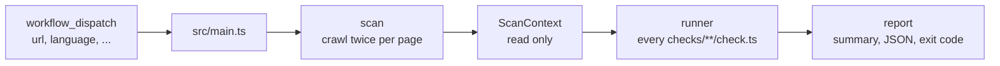

# Architecture

## Flow

1. `src/main.ts` reads the inputs and starts the scan.
2. `src/crawl.ts` visits the start page, then every link a language file names as a legal page, then a sample of the site's own pages, up to `max-pages`.
3. `src/capture.ts` loads each page twice in Chromium: once with JavaScript off and once with it on. It records status, headers, visible text, links and buttons, requests, cookies and localStorage. It never clicks.
4. `src/context.ts` wraps the result in a read-only `ScanContext` with helpers.
5. `src/runner.ts` runs every check on its own, with a timeout. One broken check becomes `error` and the rest still run.
6. `src/report.ts` writes the Markdown summary and the JSON report. `main.ts` sets the exit code from `fail-on`.

## Why two loads per page

Mandatory information has to be easy to find for everyone. If the imprint link only exists after JavaScript runs, visitors without JavaScript and many crawlers never see it. Comparing both loads makes this a plain fact a check can read: `ctx.start.noJs` against `ctx.start.js`.

Both loads happen without interaction, so every request and cookie in the context happened before consent.

## Layout

| Path | Content |
|---|---|
| `src/sdk.ts` | The only API for checks: types, result helpers, `ScanContext` |
| `src/` | Crawler, context, runner, report, CLI |
| `checks/<category>/<name>/` | One check: `check.ts`, `test.ts`, `fixtures/` |
| `lang/*.yml` | Words per language, as regular expressions |
| `data/third-parties.yml` | Known services, their hosts and cookies |
| `test/helpers.ts` | Serves a fixture on localhost and scans it |
| `action.yml` | Composite action: Node 24, Playwright, scan, upload report |

## Choices

- TypeScript without a build step. Node 24 runs `.ts` files directly; `tsc` only type-checks.
- Two runtime dependencies: `playwright` and `yaml`.
- Tests use `node:test` and real Chromium against local fixtures. Requests to other hosts are recorded, then blocked, so tests run offline.
- The runner location is part of the result. GitHub-hosted runners are in the US; the report says so.
